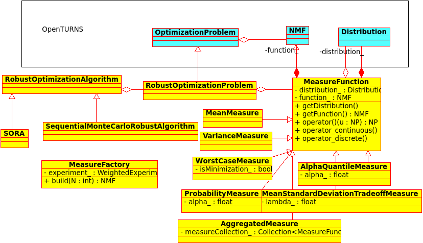

Architecture considerations
===========================

Dependencies
------------

Several dependencies are needed in order to build:

 - OpenTURNS
 - Sphinx-doc (optional for this doc)

Compilation
-----------

.. code-block:: bash

    cd otrobopt
    mkdir -p build && cd build
    cmake \
      -DCMAKE_INSTALL_PREFIX=$PWD/install \
      -DOpenTURNS_DIR=$PWD/../../openturns/build/install/lib/cmake/openturns \
      ..

Documentation
-------------

The HTML documentation is generated with Sphinx from :file:`python/doc`.  It
requires Sphinx, numpydoc, sphinx-gallery, sphinx-copybutton and matplotlib;
when one of them is missing, CMake disables the documentation and prints
``Disabling documentation``.

Configure the build with ``-DUSE_SPHINX=ON`` and build the ``doc`` target:

.. code-block:: bash

    cmake -DUSE_SPHINX=ON -DCMAKE_INSTALL_PREFIX=$PWD/install \
      -DOpenTURNS_DIR=<openturns-install>/lib/cmake/openturns ..
    make doc

The HTML output is written to :file:`build/python/src/sphinx_build/html`, and
``make install`` installs it under ``<prefix>/share/doc/otrobopt/html``.
The ``doc`` target is a convenience alias for ``sphinx_html``, which is part of
the default build.  ``SPHINX_FLAGS`` controls the Sphinx command line; it
defaults to ``-W -T``, so any warning fails the build.

Continuous integration builds the documentation with the same flags and
uploads the result as the ``sphinx-doc`` artifact of every workflow run.  The
run summary contains a download link and the entry point of each theory page,
so that reviewers can audit a pull request without checking out the branch.
Every push publishes the result to
``https://openturns.github.io/otrobopt/<branch>/`` when the ``GH_TOKEN``
secret is configured, where ``<branch>`` is the pushed branch name; the main
branch is therefore available at
https://openturns.github.io/otrobopt/master/.  Without that secret, a fork
publishes to its own GitHub Pages site at
``https://<owner>.github.io/otrobopt/<branch>/`` with the workflow token,
provided that Pages is enabled on the ``gh-pages`` branch; the upstream
repository skips the publication.  A preview is removed by the
``Clean up documentation previews`` workflow when its branch is deleted or its
pull request is closed; it can also be removed manually with a
``workflow_dispatch`` run.

Source code structure
---------------------

Here is the global class diagram for each layer:

