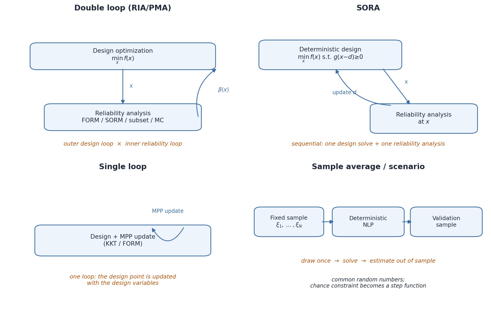

.. _robust-optimization-algorithms:

Specialized algorithms
======================

.. currentmodule:: otrobopt

The generic :class:`~otrobopt.RobustOptimizationProblem` accepts any
robustness or reliability measure, and the canonicalizer reduces it to a
deterministic problem over :math:`y=(x,s)`.  This is the reference
implementation: it is exact, it supports every measure, and it makes no
assumption on the reliability structure.  Some algorithms exploit a narrower
structure and therefore use the dedicated :class:`~otrobopt.RBDOProblem`:

* a scalar classical :class:`~openturns.Function` objective;
* one :class:`~otrobopt.JointChanceMeasure` constraint;
* deterministic bounds, inequality constraints and equality constraints.

The class keeps the distribution parameter fixed by default.  The canonical
problem returned by :meth:`~otrobopt.RBDOProblem.getCanonicalProblem` freezes
it; the overloads that accept
:class:`~otrobopt.CanonicalizationOptions` expose the active parameter
:math:`s` in the canonical decision vector.  The canonical inequality
constraint gathers the joint chance index first and the deterministic
inequalities afterwards.  The measure itself stays available through
:meth:`~otrobopt.RBDOProblem.getCanonicalJointChanceMeasure`, so an algorithm
reads the target probability and the comparison operator from the measure
instead of inferring them from the index value.

The algorithms below are optional: when the structure is not present, the
canonicalizer and a general nonlinear solver remain the fallback.  They are
added incrementally, and the summary table at the end records the current
status.

Problem class
-------------

The primary target of the specialized algorithms is the reliability-based
design problem

.. math::

    \begin{aligned}
    \min_{x \in \mathcal{X}} \quad & f(x) \\
    \text{subject to} \quad
    & \ProbCond{\cD}{g(x;\Theta) \ge 0} \ge \alpha,
    \end{aligned}

where :math:`f` is a deterministic cost, :math:`g` is a vector-valued limit
state, :math:`\cD` is the distribution of :math:`\Theta`, and
:math:`\alpha \in (0,1)` is the target reliability.  The event
:math:`g(x;\Theta) \ge 0` is read componentwise, as in
:class:`~otrobopt.JointChanceMeasure`.  The distribution parameter is fixed in
this formulation; the parameter-dependent case is discussed at the end.

The inner reliability problem is written in the standard space
:math:`\Xi`.  Let :math:`T` map :math:`\Xi` to :math:`\cD`, and let
:math:`G(x;\xi)=g(x;T(\xi))`.  The safe event is
:math:`\{G(x;\Xi) \ge 0\}` and the target reliability index is
:math:`\beta_t=\Phi^{-1}(\alpha)`.  For a scalar limit state, the design point
is the closest point of the limit-state surface to the origin,

.. math::

    u^\star(x) \in \argmin_{\{u : G(x;u)=0\}} \norm{u},

and the signed reliability index is
:math:`\beta(x)=\operatorname{sign}(G(x;0))\,\norm{u^\star(x)}`.  This
formulation is the common language of the double-loop, SORA and single-loop
methods; they differ in how they solve or avoid the inner problem.

The generic canonicalizer
-------------------------

The canonicalizer solves the problem over :math:`(x,s)` with a fixed
reference :math:`\Xi`.  It is the most general method and the reference for
the others.  Its strengths are:

* it applies to every robustness and reliability measure, including quantile,
  variance, worst case and aggregated measures;
* it is exact under the invariance theorem, with no reliability
  approximation;
* it exposes the distribution parameter :math:`s` as an ordinary decision
  variable, with bounds and a starting point.

Its limits are:

* every measure evaluation may contain a quadrature, a quantile solve, a
  chance probability or an inner optimization, so the cost per iteration is
  high;
* the measure gradients are often finite differences, and chance and quantile
  measures are non-smooth, which degrades gradient-based solvers;
* it does not exploit the reliability structure, so it cannot reuse a design
  point or a reliability index between iterations.

Double-loop RIA and PMA
-----------------------

The double-loop algorithm solves the problem by an outer design optimization
and, for every candidate :math:`x`, an inner reliability analysis.  It is the
natural baseline and the reference value for the other algorithms.

Both variants start from the same safe-event convention.  Let
:math:`\sigma=+1` for a ``Greater`` operator and :math:`\sigma=-1` for a
``Less`` operator, and let :math:`G_j(x;T(\xi))` be the limit-state components
in the standard space.  The scalarized limit state is

.. math::

    s(x;\xi) = \sigma \min_{1 \le j \le n_g} G_j(x;T(\xi)).

For a ``Greater`` operator the safe event is the intersection
:math:`\{s(x;\Xi) \ge 0\}` and the safe target is :math:`p_s=\alpha`.  For a
``Less`` operator the measure integrates the event
:math:`\{G(x;\Theta) \ge 0\}` and the safe event is its complement, the union
:math:`\{\exists j : G_j(x;\Theta) < 0\}`, so :math:`\sigma=-1` and
:math:`p_s=1-\alpha`.  The scalarization is applied before the sign change,
which is why :math:`s` is not :math:`\min_j \sigma G_j` for a ``Less``
operator.

Write :math:`\beta_t=\Phi^{-1}(p_s)`.  The double-loop algorithm requires
:math:`0.5 < p_s < 1` so that :math:`\beta_t` is positive.

In the reliability index approach (RIA), the inner problem finds the design
point

.. math::

    u^\star(x) \in \argmin_{\{u : s(x;u)=0\}} \norm{u},

and the signed reliability index is
:math:`\beta(x)=\operatorname{sign}(s(x;0))\,\norm{u^\star(x)}`.  A negative
index means that the origin of the standard space already belongs to the
failure domain.  The outer problem is

.. math::

    \min_x f(x) \quad \text{subject to} \quad \beta(x)-\beta_t \ge 0.

In the performance measure approach (PMA), the inner problem minimizes the
scalarized limit state on the target sphere,

.. math::

    u^\star(x) \in \argmin_{\{u : \norm{u}=\beta_t\}} s(x;u),

and the outer constraint is :math:`s(x;u^\star(x)) \ge 0`.  The outer
constraint reported by the algorithm is the performance measure at that
point.  Both inner problems are solved with the configured inner solver, by
default :class:`~openturns.Cobyla`, because the min-scalarization of a vector
limit state is nonsmooth.

The joint-chance treatment is explicit.  With
``DoubleLoopRBDOAlgorithm.EXACT`` the algorithm uses the single scalarized
limit state above.  This is a first-order reliability approximation of the
joint event: it is not an exact system probability, even when the components
are independent and Gaussian.  With
``DoubleLoopRBDOAlgorithm.BONFERRONI`` the joint event is replaced by the
:math:`n_g` component events with the conservative target

.. math::

    \alpha_c = 1 - \frac{1-p_s}{n_g},

so that :math:`\Prob{\cup_j \{G_j < 0\}} \le n_g(1-\alpha_c) = 1-p_s`.  The
component target must satisfy :math:`\alpha_c > 0.5`; otherwise the algorithm
rejects the problem and asks for the exact treatment or a sample-based
algorithm.

**Strengths.**

* It is simple, it supports any inner reliability method (FORM, SORM, subset
  simulation, Monte Carlo), and it returns a reliability index and a design
  point, which are useful diagnostics.
* It is the natural reference for validating SORA and the single-loop method.
* PMA is often more robust than RIA when the limit state is nonlinear,
  because it works with a performance measure on a fixed sphere instead of
  looking for the intersection of a curved surface with a hyperplane.

**Limits.**

* The cost is the product of the outer iterations and the inner reliability
  solves; each inner solve may require many limit-state evaluations.
* The scalarized limit state is nonsmooth, and the inner solver may converge
  to a local design point when the limit state is nonconvex.
* The ``EXACT`` joint-chance mode is a FORM approximation, not an exact system
  probability.  The ``BONFERRONI`` mode is conservative.
* The method applies to a fixed distribution; it does not expose :math:`s` as
  a decision variable.

SORA
----

Sequential optimization and reliability assessment (SORA) decouples the
design and reliability loops.  At iteration :math:`k`, let :math:`x^{(k)}` be
the current design and let

.. math::

    \theta^{*(k)} = T\bigl(u^{*(k)}\bigr)

be the physical image of the target point found by a performance-measure
analysis at :math:`x^{(k)}`.  The physical shift is

.. math::

    d^{(k)} = x^{(k)} - \theta^{*(k)}.

The next design solves the deterministic problem with the limit-state
parameter frozen at :math:`\theta^{*(k)}`:

.. math::

    x^{(k+1)} = \argmin_{x \in \mathcal{X}} f(x)
    \quad \text{subject to} \quad
    \sigma \min_{1 \le j \le n_g} g_j\bigl(x; x^{(k)} - d^{(k)}\bigr) \ge 0.

The shift is then updated at the new design and the loop continues until both
the design and the shift change by less than the outer absolute or relative
error tolerances.

The physical shift requires :math:`\dim(x) = \dim(\Theta)`.  When the design
and random dimensions differ, the algorithm rejects the problem and points to
the double-loop or sample-based algorithms.  This is a deliberate restriction:
projecting the shift onto the design space would silently change the chance
constraint.

The joint-chance treatment is again explicit.  With
``SORARobustOptimizationAlgorithm.EXACT`` the reliability analysis uses the
single scalarized limit state :math:`\sigma\min_j g_j` and maintains one
shift.  This is a FORM approximation of the system event, not an exact system
reliability calculation.  With
``SORARobustOptimizationAlgorithm.BONFERRONI`` each component is analyzed with
the conservative target :math:`\alpha_c=1-(1-p_s)/n_g` and has its own shift.
The Bonferroni mode is more robust but conservative, and it requires
:math:`\alpha_c > 0.5`.

**Strengths.**

* It replaces the nested double loop by a sequence of deterministic design
  optimizations and reliability analyses, which is much cheaper when the
  inner reliability solve is expensive.
* It reuses the shift from one iteration to the next, so it typically needs
  fewer reliability analyses than the double loop.
* It is well suited to smooth limit states and moderate reliability levels,
  where the performance-measure analysis is reliable.

**Limits.**

* The physical shift requires :math:`\dim(x)=\dim(\Theta)`; the
  performance-measure variant only partially removes this restriction.
* There is no global convergence proof; the iteration can stall when the
  design point moves discontinuously or when the limit state is highly
  nonlinear.
* The ``EXACT`` mode is a FORM approximation of the joint event.  The
  Bonferroni mode is conservative.
* The distribution parameter is fixed in the current implementation.

.. admonition:: Algorithm (SORA)

   .. math::

       \begin{array}{l}
       \textbf{Input:} \text{ initial design } x^{(0)},\
         \text{shift } d^{(0)}=0,\
         \text{tolerances } \varepsilon_x, \varepsilon_d\\
       \textbf{Repeat:}\\
       \qquad x^{(k+1)} = \argmin_{x\in\mathcal{X}} f(x)
         \quad \text{s.t.} \quad
         \sigma\min_j g_j\bigl(x;x^{(k)}-d^{(k)}\bigr)\ge 0\\
       \qquad \text{reliability analysis at } x^{(k+1)}
         \text{ with target } p_s\\
       \qquad d^{(k+1)} = x^{(k+1)} - T\bigl(u^{*(k+1)}\bigr)\\
       \textbf{until } \norm{x^{(k+1)}-x^{(k)}} \le \varepsilon_x
         \text{ and } \norm{d^{(k+1)}-d^{(k)}} \le \varepsilon_d
       \end{array}

Sample-average approximation
----------------------------

The sample-average algorithm keeps a calibration sample
:math:`\xi_1,\dots,\xi_N` drawn once at the beginning of the run and replaces
the chance constraint by its exact empirical counterpart,

.. math::

    \widehat p_N(x)
    = \frac{1}{N} \sum_{i=1}^N
      \mathbf{1}\bigl\{\xi_i \in \mathcal{S}(x)\bigr\}
    \ge p_s,

where :math:`\mathcal{S}(x)` is the safe event defined above.  For a
``Greater`` operator this is :math:`\{G(x;\xi) \ge 0\}`; for a ``Less``
operator it is :math:`\{\exists j : G_j(x;\xi) < 0\}`.  The empirical
probability is used without a smooth surrogate, so the constraint is a step
function and the outer solver must be derivative-free.  Any target
:math:`p_s \in [0,1]` is accepted, including targets for which the reliability
index is undefined.

Because the empirical probability is piecewise constant, the solver may fail
from an infeasible starting point.  The algorithm therefore looks for a
feasible start along the gradient of the scalarized limit state and along the
coordinate directions before it calls the outer solver.  The reported solution
satisfies the empirical constraint exactly.

After the optimization, the safe probability is estimated again on an
independent validation sample and a Wilson 95% confidence interval is
reported.  The interval measures the sampling error of the validation
estimate; it does not measure the bias of the calibration sample or the
quality of the outer solver.

**Strengths.**

* It is distribution-free: it applies to any measure with finite moments,
  including mean, variance, quantile, chance and worst case, and it does not
  require a standard space or a FORM analysis.
* It handles parameter-dependent distributions naturally, because :math:`s`
  is part of the canonical decision vector.
* Common random numbers give a deterministic, reproducible problem and reduce
  the variance of the comparison between designs.

**Limits.**

* The solution depends on the calibration sample; the empirical constraint is
  a step function and the outer solver may stall or return a design that is
  feasible only for that sample.
* The sample size controls the bias and the variance, and the cost grows with
  :math:`N` and with the dimension of :math:`y`.
* The validation interval quantifies the sampling error only; a rigorous
  feasibility guarantee requires the scenario approach or a dedicated
  chance-constrained method.
* The method does not exploit the reliability structure and can be expensive
  when the limit-state function is costly.

Single-loop methods
-------------------

The single-loop method eliminates the inner reliability loop by approximating
the most probable point as a function of the design.  For FORM, the KKT
conditions of the reliability problem give the design point as the solution
of a small system that can be updated together with the design.  The method
then solves one design loop with the updated design point.

**Strengths.**

* It is the cheapest of the reliability-based methods: it avoids a full inner
  reliability solve at every outer iteration.
* It is accurate for smooth limit states and moderate reliability levels, and
  it is easy to combine with a gradient-based design solver.

**Limits.**

* It relies on a FORM/KKT approximation of the design point, so it is less
  robust than SORA when the limit state is highly nonlinear or the target
  probability is extreme.
* It is naturally formulated for individual chance constraints; the joint
  event requires an additional treatment.
* It is planned, not yet implemented.

Scenario and cutting-plane methods
----------------------------------

The scenario approach draws :math:`N` independent scenarios and enforces the
constraints for every scenario.  For convex problems, the scenario solution
is feasible for the true chance constraint with a confidence that depends on
:math:`N`, the number of decision variables and the confidence level.  The
sample size grows with the dimension and with the inverse of the confidence,
which limits the method to moderate dimensions.

Cutting-plane and conditional-value-at-risk (CVaR) approximations replace the
joint chance constraint by a convex conservative approximation and add
violated scenarios iteratively.  They provide a deterministic outer
approximation and can be combined with a linear or convex solver.

**Strengths.**

* They provide a probabilistic feasibility guarantee for convex problems,
  without a FORM approximation.
* They are distribution-free and apply to joint chance constraints directly.
* They are complementary to SORA: SORA is design-driven, while scenario and
  cutting-plane methods are sample-driven outer approximations.

**Limits.**

* The guarantee requires convexity; for nonconvex problems the scenario
  solution is only a heuristic.
* The sample size grows with the dimension and the confidence, and the
  resulting problem can be large.
* The CVaR approximation is conservative and changes the feasible set.
* They are planned, not yet implemented.

Bilevel worst case and alternating parameter optimization
---------------------------------------------------------

A :class:`~otrobopt.WorstCaseMeasure` is an inner optimization problem over
the support of :math:`\Theta` or over an explicit optimization domain.  A
specialized algorithm alternates the outer design optimization with the inner
adversarial optimization, or solves the inner problem by duality when the
constraint is convex in :math:`\theta`.  The domain policy of
:ref:`robust-optimization-parameter-dependence` is part of the algorithm
contract: the inner problem must use the explicit optimization domain stored
on the measure, not the range of a reference distribution that may be
unbounded.

When the distribution parameter :math:`s` is a decision variable and the
canonical problem is large, an alternating scheme solves the design
subproblem with :math:`s` fixed and the parameter subproblem with :math:`x`
fixed.  It is easy to implement with existing solvers and can provide a good
warm start for the canonicalizer.

**Strengths.**

* The worst-case formulation handles adversarial uncertainty and bounded
  uncertainty sets, which the mean and chance measures do not capture.
* Alternating optimization scales to large :math:`n_s` and avoids a single
  large canonical problem.

**Limits.**

* The inner adversarial problem can be nonconvex, and a local inner solver
  only gives an upper bound on the worst case.
* Alternating optimization has no global convergence guarantee and can stall
  at a coordinatewise local minimum.
* It is a heuristic, not a replacement for the canonicalizer.

Graphical illustration
----------------------

   Loop structure of the algorithm families.  The double loop nests a
   reliability analysis inside the design loop; SORA replaces the inner loop
   by a shift update; the single-loop method updates the design point inside
   one loop; the sample-average and scenario methods solve one deterministic
   problem on a fixed sample and validate it out of sample.

Interaction with parameter-dependent distributions
--------------------------------------------------

The RBDO algorithms (SORA, single loop, double loop) are formulated for a
fixed distribution :math:`\cD`.  They apply directly when :math:`s` is fixed.
When :math:`s` is a decision variable, there are two supported routes: an
outer loop over :math:`s`, solving an RBDO subproblem for each value; or
canonicalize first and use the sample-average or scenario algorithms over
:math:`y=(x,s)`.  A generalized SORA with a shift in the joint :math:`(x,s)`
space and a reliability mapping through :math:`T_s` is a research extension,
not part of the current implementation.  This limitation is stated in the
class docstrings and in this page.

Summary
-------

.. list-table::
   :header-rows: 1
   :widths: 16 22 10 12 20 20 8

   * - Algorithm
     - Applicability
     - Joint chance
     - Cost
     - Main strength
     - Main limit
     - Status
   * - Canonicalizer
     - any measure, parameter-dependent :math:`\cD_s`
     - exact measure
     - high per iteration
     - general and exact
     - nested evaluations, finite-difference gradients
     - implemented
   * - Double loop (RIA/PMA)
     - deterministic objective, chance constraint, fixed :math:`\cD`
     - FORM or Bonferroni
     - outer x inner
     - reference, reliability diagnostics
     - expensive, nonsmooth inner problem
     - implemented
   * - SORA
     - deterministic objective, chance constraint, fixed :math:`\cD`
     - FORM or Bonferroni
     - design + few reliability analyses
     - cheaper than the double loop
     - :math:`\dim(x)=\dim(\Theta)`, no global proof
     - implemented
   * - SAA
     - any measure, fixed or canonicalized :math:`\cD_s`
     - empirical
     - sample size x evaluations
     - distribution-free, handles :math:`s`
     - sample bias, step constraint
     - implemented
   * - Single loop
     - deterministic objective, individual chance, smooth limit state
     - FORM/KKT
     - one loop
     - fastest reliability method
     - smooth limit state, moderate :math:`\alpha`
     - planned
   * - Scenario / cutting plane
     - joint chance, convex deterministic problem
     - scenario guarantee
     - scenarios x solver
     - probabilistic guarantee
     - convexity, large sample
     - planned
   * - Bilevel worst case
     - worst-case measure, bounded domain
     - n/a
     - outer x inner
     - adversarial uncertainty
     - nonconvex inner problem
     - planned
   * - Alternating parameter
     - parameter-dependent :math:`\cD_s`, large :math:`n_s`
     - via subproblems
     - two subproblems per iteration
     - scales in :math:`n_s`
     - no global guarantee
     - planned
